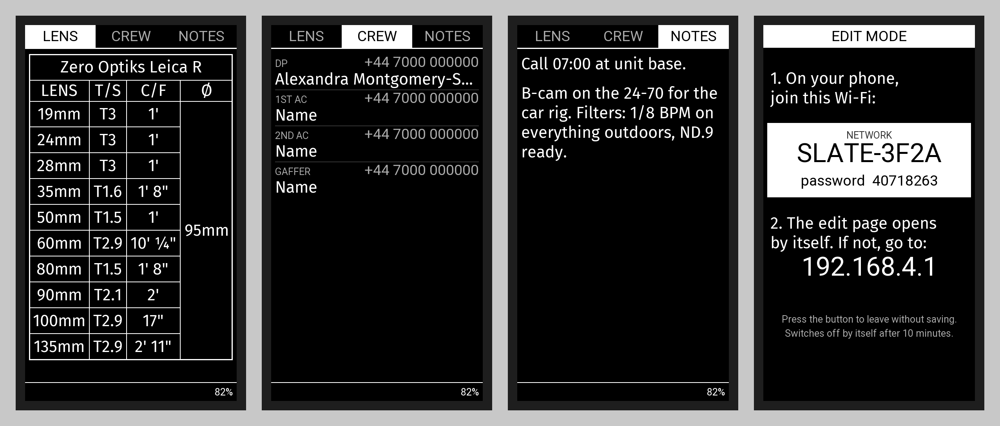

# Lens Slate

A DIY e-paper lens chart for the camera body, built on a **LilyGo T5 4.7"** e-paper board.
It has three pages: **Lens**, **Crew** and **Notes**, and you edit everything from your phone over Wi-Fi.
You don't need an app.

The lens page is laid out like a printed lens card: a title row, then **LENS | T/S | C/F | Ø**.
When every lens has the same front diameter, Ø is shown once in a tall merged cell.
If you leave Ø empty, that column disappears.
Text can include ¼ ½ ¾, ' and ", so imperial close-focus marks work.

## Using it

| Action | What happens |
|---|---|
| Power on / reset | Shows the Lens page, then sleeps |
| Short press of the user button | Next page (Lens → Crew → Notes), then sleeps |
| Hold the button for 3 s | **Edit mode**: the screen shows a Wi-Fi name and password |
| In edit mode, join that Wi-Fi on your phone | The edit page pops up (or go to `http://192.168.4.1`) |
| Tap **Save to slate** | The screen updates and goes back to sleep |
| Press the button in edit mode | Leaves without saving (edit mode also turns off after 10 minutes) |

The board sleeps between button presses, and the e-paper keeps the picture with no power.
Battery life depends mostly on how often you flip pages.
The "user button" is the one that isn't RST or BOOT: GPIO21 on the S3 board, GPIO34 on the older board.

The screen is used **portrait** (540 × 960). If it ends up upside down on your rig, tick
**Flip screen upside down** on the edit page.

Tick **White text on black** on the edit page for the inverted look:

## Building

1. Install [PlatformIO](https://platformio.org/install) (the VS Code extension is easiest).
2. Open this `lens-slate` folder.
3. Plug the board in over USB and upload. Pick the version you have:
   - newer **ESP32-S3** board: `pio run -e T5-ePaper-S3 -t upload`
   - older **ESP32 (WROVER)** board: `pio run -e T5-ePaper -t upload`

PlatformIO downloads the LilyGo display library and ArduinoJson by itself.
The S3 version sometimes needs to be in download mode for the first upload:
hold BOOT, press RST, release BOOT.

## Files

- `src/main.cpp`: sleep and button handling, battery reading, Wi-Fi edit mode, saving
- `src/render.cpp`: the page layouts
- `src/gfx.cpp`: portrait drawing and text (the LilyGo library only draws landscape)
- `src/web_page.h`: the phone edit page
- `tools/preview/`: builds the layouts on a computer and writes PNG previews, so you can tweak
  the design without flashing (`./build.sh <LilyGo-EPD47 checkout> <ArduinoJson checkout>`)

## Licence note

The LilyGo display library is GPL-3.0, so firmware built with it falls under the GPL if you
share the compiled firmware.
