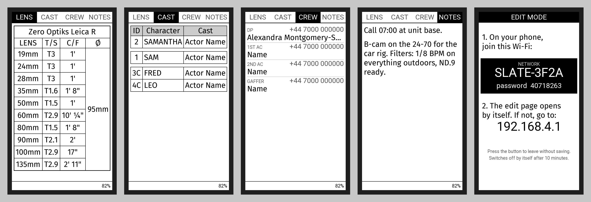

# Lens Slate

A DIY e-paper lens chart for the camera body, built on the **LilyGo T5 4.7" S3 E-Paper Pro**
(the version with a case and built-in battery). It also builds for the plain T5 4.7" boards.
It has four pages: **Lens**, **Cast**, **Crew** and **Notes**, and you edit everything from your phone over Wi-Fi.
You don't need an app.

The lens page is laid out like a printed lens card: a title row, then **LENS | T/S | C/F | Ø**.
When every lens has the same front diameter, Ø is shown once in a tall merged cell.
If you leave Ø empty, that column disappears.
Text can include ¼ ½ ¾, ' and ", so imperial close-focus marks work.

The cast page ("runs and rides") is a table of **ID | Character | Cast**. Add a *gap* on the edit
page to split it into groups, such as who's in which car. Long names wrap onto two lines, and the
table switches to a narrower font if needed so names aren't cut off.

## Using it

| Action | What happens |
|---|---|
| Power on / reset | Shows the Lens page, then sleeps |
| Short press of the button | Next page (Lens → Cast → Crew → Notes), then sleeps |
| Hold the button for 3 s | **Edit mode**: the screen shows a Wi-Fi name and password |
| In edit mode, join that Wi-Fi on your phone | The edit page pops up (or go to `http://192.168.4.1`) |
| Tap **Save to slate** | The screen updates and goes back to sleep |
| Press the button in edit mode | Leaves without saving (edit mode also turns off after 10 minutes) |

The board sleeps between button presses, and the e-paper keeps the picture with no power.
Battery life depends mostly on how often you flip pages.

**Which button:** on the **Pro** it's the side button marked **BOOT**. On the plain T5 boards it's
the user button that isn't RST or BOOT (GPIO21 on the S3 version, GPIO34 on the original).

On the Pro the battery % comes from its fuel-gauge chip, and shows `CHG` while charging.

The screen is used **portrait** (540 × 960). If it ends up upside down on your rig, tick
**Flip screen upside down** on the edit page.

Tick **White text on black** on the edit page for the inverted look:

## Building

1. Install [PlatformIO](https://platformio.org/install) (the VS Code extension is easiest).
2. Open this `lens-slate` folder.
3. Plug the board in over USB and upload. Pick the board you have:

   | Board | Command |
   |---|---|
   | **T5 S3 E-Paper Pro, revision H752-01** (current) | `pio run -e T5-ePaper-S3-Pro -t upload` |
   | T5 S3 E-Paper Pro, older revision **H752** | `pio run -e T5-ePaper-S3-Pro-H752 -t upload` |
   | Plain T5 4.7", ESP32-S3 version | `pio run -e T5-ePaper-S3 -t upload` |
   | Plain T5 4.7", original ESP32 version | `pio run -e T5-ePaper -t upload` |

   The Pro's revision is printed on its circuit board. If the screen stays blank with the H752-01
   build, try the H752 build.

PlatformIO downloads the display library (FastEPD for the Pro, LilyGo-EPD47 for the plain T5) and
ArduinoJson by itself. For the first upload the board may need to be in download mode:
hold BOOT, press RST, release BOOT.

**Status:** the screen layouts have been checked by rendering them on a computer (images above),
but this firmware has not yet been compiled or run on real hardware. Expect to fix small things on
the first build.

## Files

- `src/main.cpp`: page flipping, Wi-Fi edit mode, saving
- `src/board_t5pro.cpp`, `src/board_t5.cpp`: everything board-specific (display, battery, button,
  sleep), one file per board, behind the interface in `src/board.h`
- `src/render.cpp`: the page layouts
- `src/gfx.cpp`: portrait drawing and text, shared by every board
- `src/fonts/`: the fonts (from the LilyGo-EPD47 library)
- `src/web_page.h`: the phone edit page
- `tools/preview/`: builds the layouts on a computer and writes PNG previews, so you can tweak
  the design without flashing (`./build.sh <ArduinoJson checkout>`)

## Licence note

The fonts and the plain-T5 display library come from LilyGo-EPD47, which is GPL-3.0, so firmware
built from this project falls under the GPL if you share the compiled firmware.
